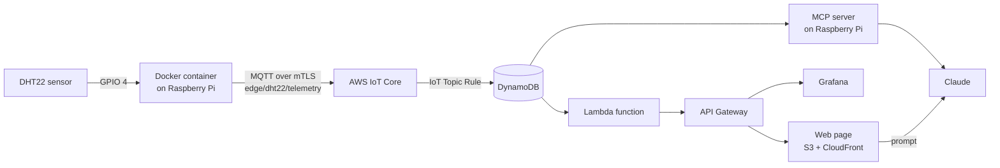
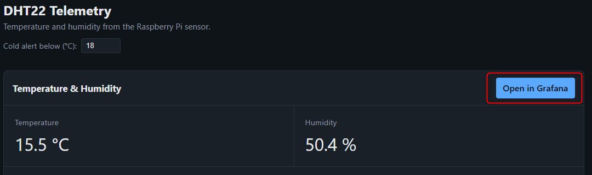
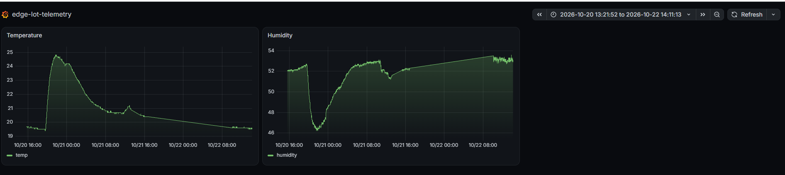

# Edge IoT Platform

An end-to-end IoT telemetry platform. A **DHT22** temperature/humidity sensor is sampled on a **Raspberry Pi** inside a **Docker** container. Readings are published over **MQTT** to **AWS IoT Core**, stored in **DynamoDB**, and served through **API Gateway + Lambda** to a **web page** and a **Grafana** dashboard. An **MCP server** running on the Pi also lets you ask **Claude** questions about the telemetry data in plain language.

All cloud infrastructure is provisioned with **Terraform**. Builds and deployments are automated with **GitHub Actions**.

---

## Architecture / Data Flow



1. **DHT22 sensor**: wired to the Raspberry Pi on GPIO 4 (physical pin 7).
2. **Docker container (Raspberry Pi)**: [edge/dht22_read.py](edge/dht22_read.py) runs in a container built from [docker/dockerfile](docker/dockerfile). It reads temperature and humidity at a configurable interval (`IOT_PUBLISH_INTERVAL_S`) and builds a JSON payload:
   ```json
   { "timestamp": 1730000000, "device_id": "edge-dht22-sensor", "temperature_c": 19.9, "temperature_f": 67.8, "humidity": 55.7 }
   ```
3. **MQTT**: the payload is published with QoS 1 to the topic `edge/dht22/telemetry`. The connection uses mutual TLS (X.509 device certificates generated by Terraform).
4. **AWS IoT Core**: receives the message. An IoT Topic Rule forwards each message to DynamoDB. Rule errors are logged to CloudWatch ([terraform/dynamodb.tf](terraform/dynamodb.tf)).
5. **DynamoDB**: stores the telemetry in the table `edge-dht22-telemetry-DB` (partition key `device_id`, sort key `timestamp`).
6. **Lambda function**: [lambda/lamba_export_to_grafana.py](lambda/lamba_export_to_grafana.py) queries DynamoDB and returns the data as JSON for the front-ends.
7. **API Gateway**: an HTTP API exposes the Lambda function ([terraform/grafana_json_export.tf](terraform/grafana_json_export.tf)).
8. **Web page**: a static page hosted on S3 behind CloudFront ([terraform/website.tf](terraform/website.tf), [terraform/website/index.html.tftpl](terraform/website/index.html.tftpl)). It shows the latest reading, a configurable cold alert, and a button that opens Grafana.
9. **Grafana**: reads the same API Gateway endpoint and plots temperature and humidity over time.

---

## Screenshots

### Web page: latest telemetry and Grafana link



### Grafana dashboard



### Ask Claude about the telemetry

Send a prompt:


Receive the response:


---

## MCP Server on the Raspberry Pi

A Model Context Protocol (MCP) server ([MCP-server/iot_telemetry_server.py](MCP-server/iot_telemetry_server.py)) runs on the Pi in Docker ([MCP-server/docker-compose.yml](MCP-server/docker-compose.yml)) and listens on port `8000` (SSE transport). It reads DynamoDB directly and exposes these tools to Claude:

| Tool | Description |
|------|-------------|
| `get_latest_telemetry` | Returns the most recent temperature/humidity reading. |
| `get_telemetry_range` | Returns readings between two ISO timestamps. |
| `analyze_environmental_correlation` | Computes the Pearson correlation between temperature and humidity over a time range. |

Start it on the Pi:

```bash
cd MCP-server
docker compose up -d --build
```

AWS credentials are mounted read-only from `~/.aws` on the Pi.

### Asking Claude questions

A small FastAPI service ([Web_browser_connection/receive_request.py](Web_browser_connection/receive_request.py)) runs on the Pi and accepts `POST /mcp` with a `message` (or `prompt`) field. It passes the prompt to the Claude CLI, which calls the MCP server tools and returns the answer to the web page.

Example prompts:

- *Give me the latest temperature and humidity reading.*
- *Give me the average temperature on October 28th.*
- *Given the telemetry data, is there any correlation between temperature and humidity on 29th October?*
- *Take 10 samples every 2 seconds and give them to me.*

For Claude Desktop, see [MCP-server/claude_desktop_config.json](MCP-server/claude_desktop_config.json).

---

## Infrastructure as Code (Terraform)

All AWS resources are defined in [terraform/](terraform/):

| File | Resources |
|------|-----------|
| [main.tf](terraform/main.tf) | IoT Thing, device certificate, IoT policy, local cert files |
| [dynamodb.tf](terraform/dynamodb.tf) | IoT Topic Rule to DynamoDB, IAM roles, CloudWatch error logs |
| [grafana_json_export.tf](terraform/grafana_json_export.tf) | Lambda function, API Gateway HTTP API, IAM, logs |
| [website.tf](terraform/website.tf) | S3 bucket, bucket policy, `index.html` upload (CloudFront) |
| [backend.tf](terraform/backend.tf) | Remote state backend |
| [outputs.tf](terraform/outputs.tf) | Website URL, API Gateway URL, etc. |

---

## Automation (GitHub Actions)

| Workflow | Purpose |
|----------|---------|
| [dht22-crosscomp.yml](.github/workflows/dht22-crosscomp.yml) | Cross-compiles the DHT22 Docker image for `linux/arm64` (QEMU + buildx) and pushes it to GHCR. |
| [terraform.yml](.github/workflows/terraform.yml) | Runs Terraform `plan` / `apply` / `plan-apply` / `destroy`. After apply, it connects to the Pi via Tailscale + SSH, copies the IoT certificates, pulls the image, restarts the sensor container, prints the deployment URLs, and checks that fresh telemetry reaches the API ([tests/check_grafana_timestamp.py](tests/check_grafana_timestamp.py)). |
| [restart-pi.yml](.github/workflows/restart-pi.yml) | Reboots the Raspberry Pi remotely over Tailscale + SSH. |

### Required secrets

`AWS_ACCESS_KEY_ID`, `AWS_SECRET_ACCESS_KEY`, `GHCR_PACKAGE_TOKEN`, `TS_OAUTH_CLIENT_ID`, `TS_OAUTH_SECRET`, `DEVICE_HOST`, `DEVICE_SSH_USER`, `DEVICE_SSH_PRIVATE_KEY`, `DEVICE_KNOWN_HOSTS`, `WEBSITE_CERTIFICATE_ARN`, `WEBSITE_CLOUDFRONT_DISTRIBUTION_ID`, `WEBSITE_CLOUDFRONT_OAC_ID`.

---

## Repository Layout

```
docker/                  Dockerfile + requirements for the sensor container
edge/                    DHT22 read + MQTT publish script
lambda/                  Lambda exporting DynamoDB data as JSON
MCP-server/              MCP server exposing telemetry tools to Claude
Web_browser_connection/  FastAPI bridge from the web page to Claude CLI
terraform/               AWS infrastructure (IoT Core, DynamoDB, Lambda, API GW, S3/CloudFront)
tests/                   Post-deploy telemetry freshness check
.github/workflows/       CI/CD pipelines
```
